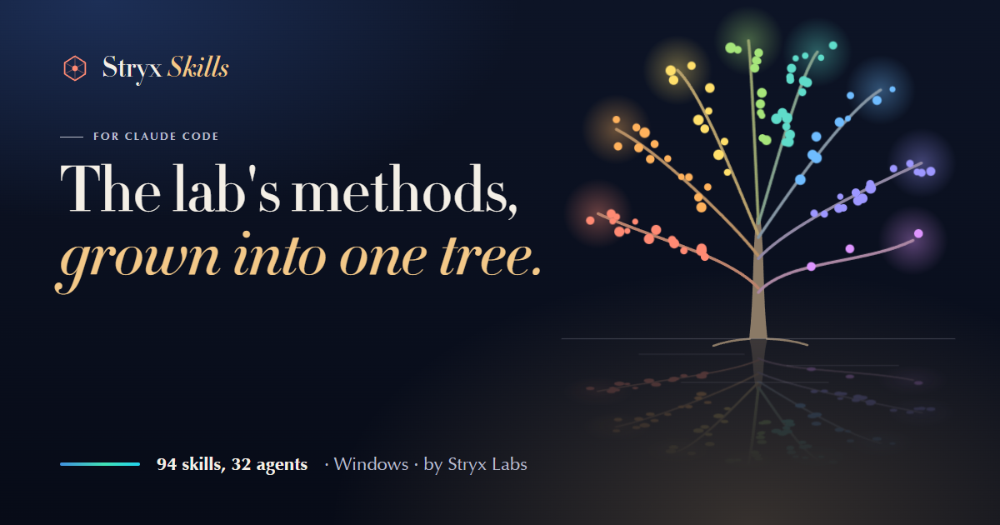

<p align="center">
  <a href="https://skills.stryxlabs.com/"></a>
</p>

# Stryx Skills

**The lab's methods, grown into one tree.**

Stryx Skills gives Claude Code the methods Stryx Labs uses on its own products: 94 skills and 32 agents, each written
for one kind of work. Claude loads the right one by itself when the moment comes.

[Install on Windows](https://skills.stryxlabs.com/#install) · [Product page](https://skills.stryxlabs.com/) ·
[Project page](https://omanishay-cyber.github.io/stryx-skills/) · [License](https://stryxlabs.com/license)

## Install

Open Windows PowerShell, paste this line and press Enter:

```powershell
irm https://skills.stryxlabs.com/install.ps1 | iex
```

Then restart Claude Code. The command installs all 94 skills, 32 agents and the brain program as one set. No skill is
offered alone. A full 3D version (25.5 GB) is on the [product page](https://skills.stryxlabs.com/#install).

Prefer a file? The Lite set is also a zip on the
[Releases page](https://github.com/omanishay-cyber/stryx-skills/releases/latest) (982 MB).

Windows today. Free to use: no fee, no subscription, no key, no sign-up.

## What it does

- **The right method, without asking.** A router picks the skills a request needs before Claude starts.
- **Done means proven.** 46 hook files act on their own: one blocks dangerous commands, one scans for secrets, one
  refuses a "done" without proof.
- **Designs held to rules.** The design brain checks every design against 62 laws and keeps 52 ready ops for glass,
  metal, water, sky and light.
- **Keys kept out of sight.** The Stryx Tools mod keeps your keys in a Vault, used by name and never shown.

## The eight groups

| Group | Skills | First book |
|---|---:|---|
| Plan and decide | 15 | `stryx:ai-power` |
| Quality | 13 | `stryx:debug` |
| Design and media | 10 | `stryx:design` |
| Languages | 12 | `stryx:electron` |
| Web and data | 17 | `stryx:integrations` |
| Writing | 9 | `stryx:writing` |
| Workflow | 15 | `stryx:devops` |
| Modes | 3 | `stryx:modes` |

The full list, with what each skill and agent is for, is on [skills.stryxlabs.com](https://skills.stryxlabs.com/).

## What is in this repository

The project page (in `docs/`, served by GitHub Pages) and the issue tracker. The skills themselves are not here: the
set installs from skills.stryxlabs.com, and its license does not allow posting it on GitHub.

## Bugs and ideas

Open an issue with the [bug form](../../issues/new?template=bug_report.yml) or the
[feature form](../../issues/new?template=feature_request.yml). Take keys and passwords out of any log before you paste
it.

## License

Stryx Skills is licensed, not sold, under the [Stryx Labs License v1.1](https://stryxlabs.com/license). Royalty-free
for any lawful purpose, including personal and commercial use. See [LICENSE](LICENSE).

---

Made by [Stryx Labs](https://stryxlabs.com/), an independent technology lab in New Jersey. Anish Trivedi & Kruti
Trivedi, 2026.
