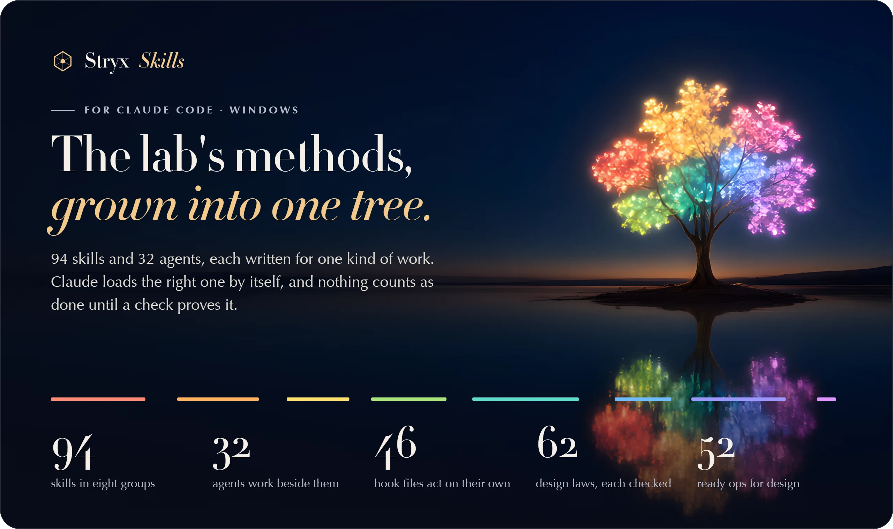
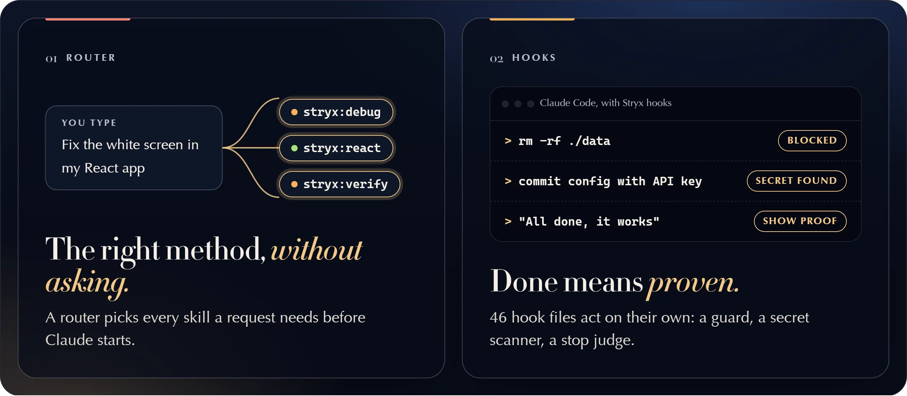
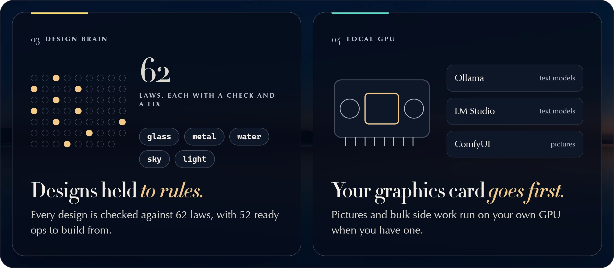
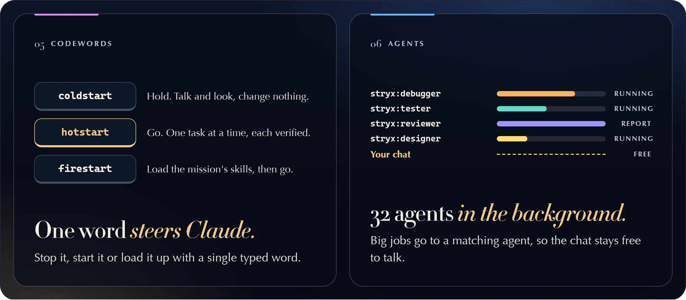
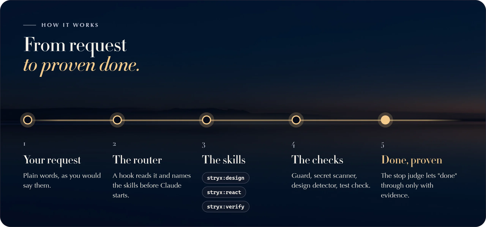

<p align="center">
  <a href="https://skills.stryxlabs.com/"><picture><source media="(prefers-color-scheme: dark)" srcset="docs/assets/readme/hero-dark.webp"><source media="(prefers-color-scheme: light)" srcset="docs/assets/readme/hero-light.webp"></picture></a>
</p>

<p align="center">
  <a href="https://github.com/omanishay-cyber/stryx-skills/releases/latest"></a>   <a href="#install"></a>   <a href="https://skills.stryxlabs.com/"></a>   <a href="#all-94-skills"></a>   <a href="#the-32-agents"></a>   <a href="https://stryxlabs.com/license"></a>   <a href="https://github.com/omanishay-cyber/stryx-skills/releases/latest"></a>
</p>

<p align="center"><b>Claude Code, with the working methods of a whole lab.</b><br>
94 skills and 32 agents, each written for one kind of work. Claude loads the right one by itself,<br> and nothing is called done until a check proves it.</p>

<p align="center">
  <a href="#install"><b>Install</b></a> &nbsp;·&nbsp; <a href="#what-you-get">What you get</a> &nbsp;·&nbsp; <a href="#how-it-works">How it works</a> &nbsp;·&nbsp; <a href="#all-94-skills">All 94 skills</a> &nbsp;·&nbsp; <a href="#faq">FAQ</a> &nbsp;·&nbsp; <a href="https://skills.stryxlabs.com/">Product page</a>
</p>

```powershell
irm https://skills.stryxlabs.com/install.ps1 | iex
```

<sub>Paste into Windows PowerShell, press Enter, restart Claude Code. Free to use: no fee, no subscription, no key, no sign-up.</sub>

## What you get

Six ideas carry the whole set. Each one is a habit Claude keeps without being reminded.

<p align="center">
  <picture><source media="(prefers-color-scheme: dark)" srcset="docs/assets/readme/features-1-dark.webp"><source media="(prefers-color-scheme: light)" srcset="docs/assets/readme/features-1-light.webp"></picture>
</p>

**01 · The right method, without asking.** A router hook reads each request and names the skills it needs before Claude starts. A fix in a React app gets `stryx:debug`, `stryx:react` and `stryx:verify` together. Not sure which skill fits? `stryx:ai-power` is the map of all 94.

**02 · Done means proven.** 46 hook files act on their own at fixed moments. The guard blocks dangerous commands, the secret scanner looks for keys and passwords, the test check and the stop judge refuse a "done" that has no evidence behind it. `stryx:verify` is the gate every job ends on.

<p align="center">
  <picture><source media="(prefers-color-scheme: dark)" srcset="docs/assets/readme/features-2-dark.webp"><source media="(prefers-color-scheme: light)" srcset="docs/assets/readme/features-2-light.webp"></picture>
</p>

**03 · Designs held to rules.** The `brain` program checks a design against 62 laws, each with a check and a fix, and keeps 52 ready ops for glass, metal, water, sky and light. The design detector hook flags raw colours and banned patterns after a UI edit. Every new product gets its own named look, never a template.

**04 · Your graphics card goes first.** With Ollama, LM Studio or ComfyUI on your PC, pictures and bulk side work run on your own GPU, and Claude checks what comes back. `stryx:local-ai` and `stryx:image-gen` hold the how-to.

<p align="center">
  <picture><source media="(prefers-color-scheme: dark)" srcset="docs/assets/readme/features-3-dark.webp"><source media="(prefers-color-scheme: light)" srcset="docs/assets/readme/features-3-light.webp"></picture>
</p>

**05 · One word steers Claude.** `coldstart` holds all work so you can talk and look. `hotstart` lifts the hold and works one task at a time, each verified. `firestart` loads the router and the mission's skills, then goes. `destart` runs a deep audit, and `CHS` reads your latest screenshot.

**06 · 32 agents in the background.** A big, separate job goes to a matching agent: `stryx:debugger`, `stryx:tester`, `stryx:reviewer`, `stryx:designer` and 28 more. They work in the background, so the chat stays free to talk.

<table>
<tr>
<td width="33%" valign="top"><b>Stryx Tools</b><br>Forty tools inside Claude Code, opened with <code>/stryx</code>.</td>
<td width="33%" valign="top"><b>Keys out of sight</b><br>Your keys live in one plain file on your PC. Claude uses them by name and never shows them.</td>
<td width="33%" valign="top"><b>A logbook that learns</b><br>A hook records every failure and finished turn, so the next session starts from the lesson.</td>
</tr>
</table>

## How it works

<p align="center">
  <picture><source media="(prefers-color-scheme: dark)" srcset="docs/assets/readme/flow-dark.webp"><source media="(prefers-color-scheme: light)" srcset="docs/assets/readme/flow-light.webp"></picture>
</p>

1. **You ask** in plain words, as you would say them to a colleague.
2. **The router** (a hook) reads the request and names the skills before Claude starts.
3. **The skills** load: each one says what it covers, what it hands on and how the work is proven.
4. **The checks** run on their own: the guard, the secret scanner, the design detector, the test check.
5. **Done, proven.** The stop judge lets "done" through only with evidence: the command, its result, the screenshot.

## Without it, and with it

| Without | With Stryx Skills |
|---|---|
| You name the method each time, or Claude works from memory | The router loads the matching skills before Claude starts |
| "Done" means Claude said so | The stop judge wants evidence: test output, a type check, screenshots |
| One wrong command can delete a folder | The guard blocks dangerous commands before they run |
| A key can slip into a commit | The secret scanner checks for keys and passwords |
| Designs drift to the same generic look | 62 laws, 52 ops and a design detector hold every design to rules |
| A long job blocks the chat | 32 agents take big jobs in the background |
| Stopping Claude means hoping it listens | `coldstart` holds all work until you type `hotstart` |
| Pictures and bulk work go out to a cloud model | Your own GPU goes first when you have one |

## All 94 skills

Eight groups, one colour each, the same as the branches of the tree. Open a group to see every skill in it. Claude picks them for you; the names are here so you can ask for one by name.

<details>
<summary> <b>Plan and decide</b> &nbsp;·&nbsp; 15 skills &nbsp;·&nbsp; Before the work: what to build, how, in what order, and who does it.</summary>

| Skill | What it is for |
|---|---|
| `stryx:ai-power` | the router: which skill fits, "load aipower", "is there a skill for X" |
| `stryx:brainstorm` | decide what to build: plan, scope or spec a feature, app or decision before code |
| `stryx:ideate` | ideas, improvements, quick wins, "what should we build next" |
| `stryx:strategy` | write or revisit STRATEGY.md: problem, users, positioning, metrics, not-doing |
| `stryx:prototype` | a throwaway to click through before deciding how something works or feels |
| `stryx:bakeoff` | draft several different approaches before choosing one |
| `stryx:pov` | a firm verdict for this project: adopt X? which approach? second opinion |
| `stryx:research` | evidence-based answers: find out, compare X and Y, which library, current docs |
| `stryx:architect` | system design, "how should I build this", process and IPC boundaries, INVARIANTS.md |
| `stryx:taskmaster` | implementation plan from an approved spec; break down; sprint; backlog order |
| `stryx:estimation` | how long or how big: estimates, story points, deadline forecasts |
| `stryx:plan-review` | review a spec, PRD, plan or STRATEGY.md before work starts |
| `stryx:workflow` | how much process a job needs: levels, phases, gates, PRD, project status |
| `stryx:execute` | carry a written plan to verified completion; "make it work", "keep going", "lfg" |
| `stryx:orchestrate` | work for several agents: split, fan out, race approaches, workflows |

</details>

<details>
<summary> <b>Quality</b> &nbsp;·&nbsp; 13 skills &nbsp;·&nbsp; Finding what is wrong, proving what is right, and making code better.</summary>

| Skill | What it is for |
|---|---|
| `stryx:debug` | anything broken: bug, error, crash, failing test, white screen, regression |
| `stryx:test` | tests and TDD: write, fix or review tests, regression tests, coverage |
| `stryx:verify` | before saying done, committing or pushing: run the checks, show the evidence |
| `stryx:review` | review code or a PR (giving a review) |
| `stryx:review-feedback` | act on review comments you received |
| `stryx:refactor` | restructure without changing behavior: smells, extract, rename, split, dead code, pattern migrations, major-version upgrades |
| `stryx:performance` | slow, laggy, big bundle, slow startup or build, memory; before/after numbers |
| `stryx:optimize` | a number must move: try candidates against one measurement, keep the winners |
| `stryx:security` | audits, hardening, secrets, auth, encryption, CWE / OWASP, supply-chain checks |
| `stryx:error-handling` | design error handling while building: retries, timeouts, fallbacks, messages |
| `stryx:eval` | evals for prompts, agents and an app's LLM features |
| `stryx:patterns` | onboarding to unfamiliar code, design patterns, technical debt, legacy code |
| `stryx:explain` | how or why something works, "teach me", "catch me up" on past work |

</details>

<details>
<summary> <b>Design and media</b> &nbsp;·&nbsp; 10 skills &nbsp;·&nbsp; Everything you see and hear: screens, pictures, 3D, video, sound.</summary>

| Skill | What it is for |
|---|---|
| `stryx:design` | anything visual you make: app or web GUI, dashboard, theme, brand, graphics, icons, slides, charts; one named direction per project, never generic |
| `stryx:design-audit` | checking a design: UX audit, accessibility, QA walkthrough, visual polish |
| `stryx:diagrams` | diagrams as code: flowchart, sequence, ER, state, Gantt (Mermaid) |
| `stryx:image-gen` | pictures made by an AI image model: local GPU (ComfyUI) first |
| `stryx:3d-engines` | real-time 3D in a web or Electron app: Three.js, React Three Fiber, Babylon.js |
| `stryx:3d-texturing` | PBR textures from Substance 3D Painter for web engines |
| `stryx:video` | videos made with code (Remotion): promos, explainers, captions |
| `stryx:audio` | AI audio: text-to-speech, voiceover, transcription, music, sound effects |
| `stryx:media-processing` | convert, compress or edit existing video, audio or image files (FFmpeg) |
| `stryx:game-dev` | games in a browser or Electron: Canvas 2D, Phaser, PixiJS, game loop, controls, jump feel |

</details>

<details>
<summary> <b>Languages</b> &nbsp;·&nbsp; 12 skills &nbsp;·&nbsp; One book per programming language or app platform.</summary>

| Skill | What it is for |
|---|---|
| `stryx:electron` | Electron main / preload / renderer, IPC, windows, tray, menus, auto-updater |
| `stryx:react` | React components, hooks, Zustand, re-renders, memo |
| `stryx:typescript` | types beyond the basics: unions, branded IDs, generics, strict tsconfig |
| `stryx:react-native` | React Native or Expo apps |
| `stryx:flutter` | Flutter or Dart apps |
| `stryx:python` | Python 3.11+: types, asyncio, uv, pytest, FastAPI, Django |
| `stryx:go` | Go code and services |
| `stryx:rust` | Rust and Cargo: borrow checker, tokio, clippy |
| `stryx:vba` | Excel VBA: .xlsm macros, UserForms, Ribbon XML |
| `stryx:apps-script` | Google Apps Script for Sheets and Workspace |
| `stryx:java` | Java and JVM services: records, virtual threads, Maven, Gradle, Spring Boot |
| `stryx:shell` | shell scripts and tricky command lines: PowerShell, Git Bash, sh, cmd batch files, npm scripts |

</details>

<details>
<summary> <b>Web and data</b> &nbsp;·&nbsp; 17 skills &nbsp;·&nbsp; Websites, online services, databases and the network.</summary>

| Skill | What it is for |
|---|---|
| `stryx:integrations` | third-party services: Stripe, Google Chat, Workspace CLI, API keys, webhooks |
| `stryx:mcp-server` | build an MCP server (adding one to Claude Code is `stryx:config`) |
| `stryx:rag` | RAG or search inside an app: embeddings, vector search, answers with citations |
| `stryx:scraping` | get data off websites: scrapers, crawls, blocked pages |
| `stryx:browser` | drive or inspect a live page: click, screenshot, console, network, Lighthouse |
| `stryx:seo` | SEO audit and setup: indexing, meta tags, JSON-LD, sitemaps |
| `stryx:wordpress` | a live WordPress site through WP-CLI or the REST API |
| `stryx:shopify` | a Shopify shop through the Admin API |
| `stryx:cloudflare-starter` | a new Cloudflare app from the vite-flare-starter template |
| `stryx:price-comparison` | where to buy something cheapest or in stock |
| `stryx:market-intel` | competitors, a market, a brand's public reputation |
| `stryx:ai-agents` | an AI agent inside an app: tool calling, the agent loop, state, one agent or several |
| `stryx:databases` | server databases (PostgreSQL first): slow queries, EXPLAIN, indexes, schema, live migrations |
| `stryx:data-engineering` | bulk data: pipelines, ETL / ELT, nightly loads, imports and migrations, duplicate rows |
| `stryx:networking` | a PC, phone or server that cannot be reached; ports in use, localhost, network setup |
| `stryx:containers` | Docker and Compose, image builds, a container that exits; making a running app observable |
| `stryx:infra-as-code` | servers and cloud resources as code: Terraform, OpenTofu, state, modules, DNS records |

</details>

<details>
<summary> <b>Writing</b> &nbsp;·&nbsp; 9 skills &nbsp;·&nbsp; Words for people: messages, docs, proposals, announcements.</summary>

| Skill | What it is for |
|---|---|
| `stryx:writing` | prose: draft, edit, plain English, tone, emails and messages |
| `stryx:documentation` | repo docs: README, ARCHITECTURE.md, API docs, TSDoc, user guides |
| `stryx:business-writing` | proposals, quotes, scopes of work, award and grant entries |
| `stryx:career-docs` | resume, CV, cover letter |
| `stryx:launch-copy` | public announcements of what shipped: X, LinkedIn, customer email |
| `stryx:status-update` | team, boss or client updates on what got done, and handling replies |
| `stryx:product-feedback` | turn recordings, notes or Slack / GitHub / email feedback into evidence or requirements |
| `stryx:product-pulse` | you run it (`/stryx:product-pulse`): usage, errors and latency report |
| `stryx:go-to-market` | how to sell software: pricing, free tier or trial, first customers, launch plan, channels |

</details>

<details>
<summary> <b>Workflow</b> &nbsp;·&nbsp; 15 skills &nbsp;·&nbsp; Keeping the work moving and remembered: git, handoffs, lessons, setup, tools.</summary>

| Skill | What it is for |
|---|---|
| `stryx:devops` | git, commit, PR, release, CI/CD, packaging and signing |
| `stryx:handoff` | continue in a later session: write or resume a handoff |
| `stryx:learn` | "remember this", lessons learned, session wrap |
| `stryx:repo-learnings` | write a solved problem's lesson into the repo (docs/solutions/) |
| `stryx:knowledge-graph` | a folder of files as a lasting, queryable knowledge graph |
| `stryx:config` | Claude Code setup: CLAUDE.md, settings, permissions, memory, plugins, MCP servers |
| `stryx:organize` | organize or clean up a folder, a project or the Desktop; the project home; duplicates |
| `stryx:vscode` | VS Code: .vscode, launch.json, tasks, debug configs |
| `stryx:skill-forge` | create or change a skill, agent, command or hook |
| `stryx:prompt-coach` | "coach this": shape a rough task into a good prompt for an agent |
| `stryx:diagnose-session` | what went wrong in a Claude Code session, with transcript proof |
| `stryx:local-ai` | local GPU models: Ollama, LM Studio, ComfyUI, VRAM, side work |
| `stryx:voice-agents` | talking voice or chat agents on ElevenLabs |
| `stryx:loader` | the "Stryx loader:" line: which skills a task needs loaded |
| `stryx:mneme` | the Mneme MCP tools: where is X, who calls this, what breaks if I change this, past decisions |

</details>

<details>
<summary> <b>Modes</b> &nbsp;·&nbsp; 3 skills &nbsp;·&nbsp; The words you type to steer Claude itself.</summary>

| Skill | What it is for |
|---|---|
| `stryx:modes` | the codewords: coldstart, hotstart, firestart, destart, stop orders |
| `stryx:chs` | CHS: check the latest screenshot |
| `stryx:wtf` | you run it (`/stryx:wtf`): explain the last reply or a passage in plain words |

</details>

## The 32 agents

An agent takes a big, separate job and works on it in the background, then reports back.

<details>
<summary><b>Open the list of all 32 agents</b> &nbsp;·&nbsp; 6 groups</summary>

| Group | Agent | What it does |
|---|---|---|
| Plan and build | `stryx:architect-agent` | architecture, options + pick |
|  | `stryx:planner` | roadmap with sizes, ticket triage |
|  | `stryx:plan-reviewer` | checks a plan it did not write |
|  | `stryx:project-status-analyst` | plans vs real code |
|  | `stryx:orchestrator` | conductor for big multi-part jobs |
| Quality | `stryx:debugger` | find and fix a failure |
|  | `stryx:tester` | tests, TDD |
|  | `stryx:verify-agent` | fresh check of a done claim |
|  | `stryx:reviewer` | code review verdict |
|  | `stryx:security-agent` | security audit |
|  | `stryx:perf-agent` | performance |
|  | `stryx:refactorer` | behavior-preserving change |
|  | `stryx:error-handler` | error handling plan |
|  | `stryx:toolchain-guardian` | read-only build-config audit |
| Design | `stryx:designer` | screens, pages, themes |
|  | `stryx:ux-auditor` | read-only usability check |
|  | `stryx:chart-architect` | chart-led dashboards |
|  | `stryx:i18n-localizer` | translations, RTL |
| Platforms and domain | `stryx:flutter-agent` | Flutter and Dart builds |
|  | `stryx:api-engineer` | typed API clients |
|  | `stryx:database-expert` | SQLite / sql.js |
|  | `stryx:regex-and-parser` | regex, CSV / Excel / JSON parsing |
|  | `stryx:excel-pdf` | app exports |
| Product domain | `stryx:orion-expert` | business rules of a real Electron app |
|  | `stryx:sync-engine-expert` | a sync engine with envelope encryption |
| Knowledge and ops | `stryx:researcher` |  |
|  | `stryx:mentor-agent` | teaches why and how |
|  | `stryx:documentation-writer` |  |
|  | `stryx:prompt-engineer` | skills, agents, CLAUDE.md, prompts |
|  | `stryx:devops-agent` | git / PR / release jobs |
|  | `stryx:handoff-specialist` | handoff before /clear or session end |
|  | `stryx:mneme-operator` | blast radius, callers, Mneme's own health |

</details>

## Install

**One line, the whole set.** Open Windows PowerShell, paste this line and press Enter:

```powershell
irm https://skills.stryxlabs.com/install.ps1 | iex
```

Then restart Claude Code. The command installs all 94 skills, 32 agents and the brain program as one set.

<table>
<tr>
<td width="33%" valign="top"><b>Lite, by command</b><br>The line above. The quickest way in.</td>
<td width="33%" valign="top"><b>Lite, as a zip</b><br><a href="https://github.com/omanishay-cyber/stryx-skills/releases/latest">StryxLabs-Skills-Lite-3.0.0-windows-r18.zip</a> on Releases, 982 MB.</td>
<td width="33%" valign="top"><b>Full 3D version</b><br>Adds the 3D web design skill. 25.5 GB, on the <a href="https://skills.stryxlabs.com/#install">product page</a>.</td>
</tr>
</table>

Windows today. Everything runs on your own machine.

## FAQ

<details>
<summary><b>What is a skill?</b></summary>

A written method for one kind of work: when to use it, what it covers, what it hands on, and the checks that prove it is done. Every skill also says what it is not for, and which skill takes over.

</details>

<details>
<summary><b>Does it cost anything?</b></summary>

No. There is no fee, no subscription, no key and no sign-up. The [Stryx Labs License v1.1](https://stryxlabs.com/license) allows personal and commercial use.

</details>

<details>
<summary><b>Do I have to pick the skills myself?</b></summary>

No. A router hook picks them for each request before Claude starts. You can still ask for one by name, such as `stryx:design`.

</details>

<details>
<summary><b>Which systems does it run on?</b></summary>

Windows today, inside Claude Code, on your own machine.

</details>

<details>
<summary><b>Can I install one skill on its own?</b></summary>

No. The command installs all 94 skills, 32 agents and the brain program as one set. The skills hand work to each other, so they only work fully together.

</details>

<details>
<summary><b>What does the full 3D version add?</b></summary>

The 3D web design skill, `stryx-3d-web-design`: 323 files for cinematic 3D websites. It is 25.5 GB, so it ships as a separate download on the [product page](https://skills.stryxlabs.com/#install).

</details>

<details>
<summary><b>Do I need a graphics card?</b></summary>

No. When your PC has local models (Ollama, LM Studio or ComfyUI), pictures and bulk side work go to them first. Without them, Claude does the work itself.

</details>

<details>
<summary><b>Where are my keys kept?</b></summary>

In one plain text file on your PC. Claude uses a key by its name and never shows the value in the chat.

</details>

<details>
<summary><b>Where is the source?</b></summary>

Not in this repository. It holds the project page and the issue tracker. The set installs from [skills.stryxlabs.com](https://skills.stryxlabs.com/), and its licence does not allow posting it on GitHub.

</details>

## Grow the tree

<p align="center">
  <a href="https://skills.stryxlabs.com/#install"><picture><source media="(prefers-color-scheme: dark)" srcset="docs/assets/readme/closing-dark.webp"><source media="(prefers-color-scheme: light)" srcset="docs/assets/readme/closing-light.webp"></picture></a>
</p>

<p align="center">
  <a href="#install"><b>Install it</b></a> &nbsp;·&nbsp; <a href="https://github.com/omanishay-cyber/stryx-skills"><b>Star this repository</b></a> &nbsp;·&nbsp; <a href="../../issues/new?template=bug_report.yml">Report a bug</a> &nbsp;·&nbsp; <a href="../../issues/new?template=feature_request.yml">Ask for a feature</a>
</p>

<p align="center"><sub>Take keys and passwords out of any log before you paste it into an issue.</sub></p>

## Licence

Stryx Skills is licensed, not sold, under the [Stryx Labs License v1.1](https://stryxlabs.com/license). Royalty-free for any lawful purpose, including personal and commercial use. See [LICENSE](LICENSE).

---

<p align="center"><sub>Made by <a href="https://stryxlabs.com/">Stryx Labs</a>, an independent technology lab in New Jersey.<br>Anish Trivedi &amp; Kruti Trivedi, 2026. &nbsp;·&nbsp; <a href="https://omanishay-cyber.github.io/stryx-skills/">Project page</a></sub></p>
